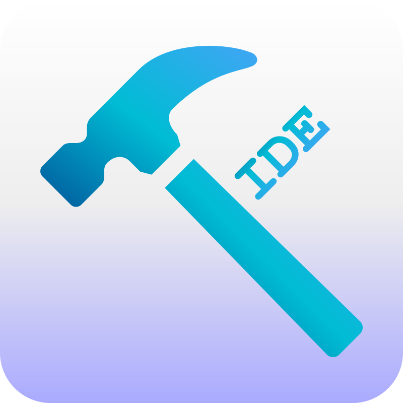
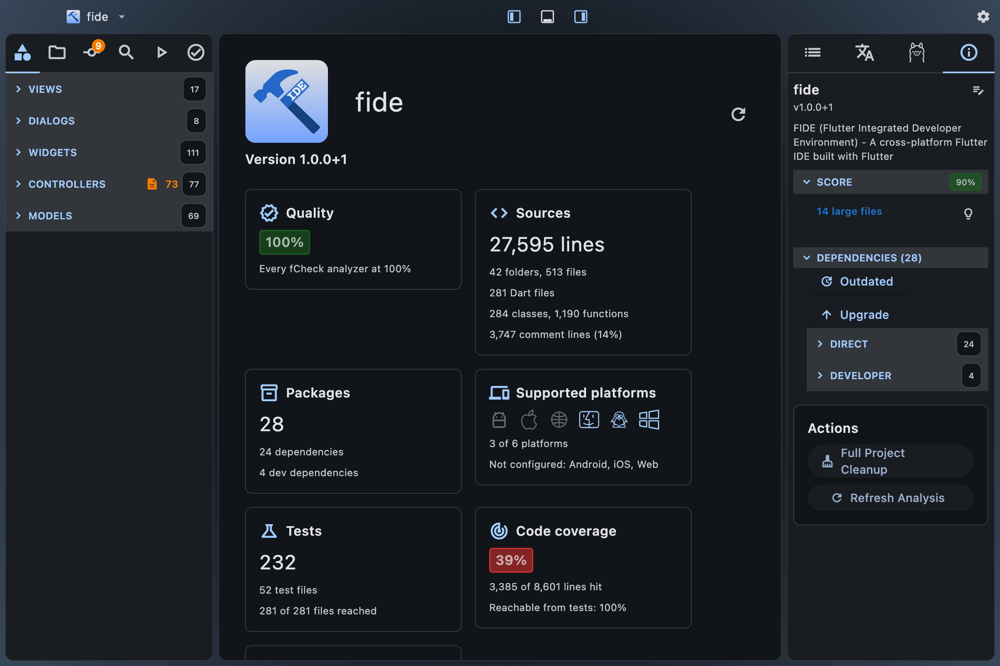
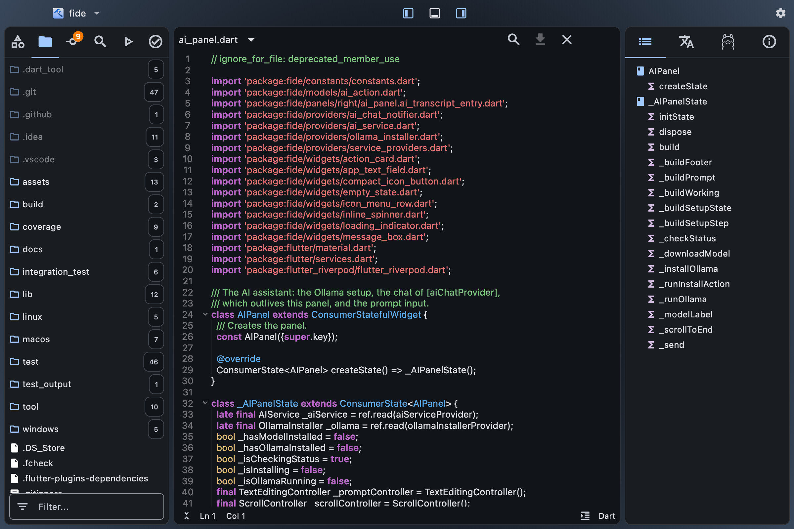
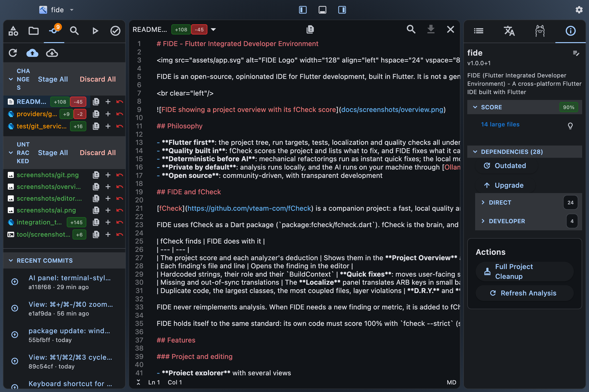
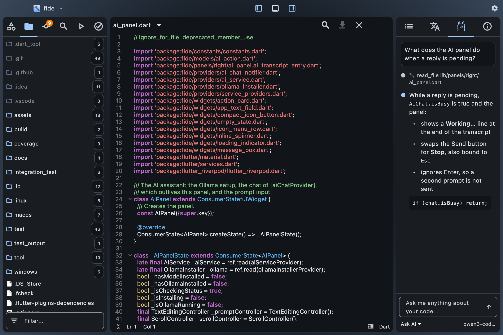
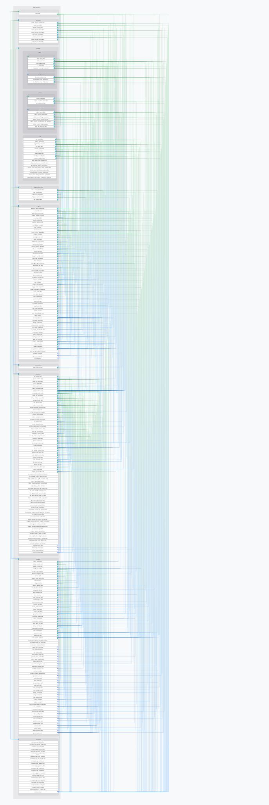
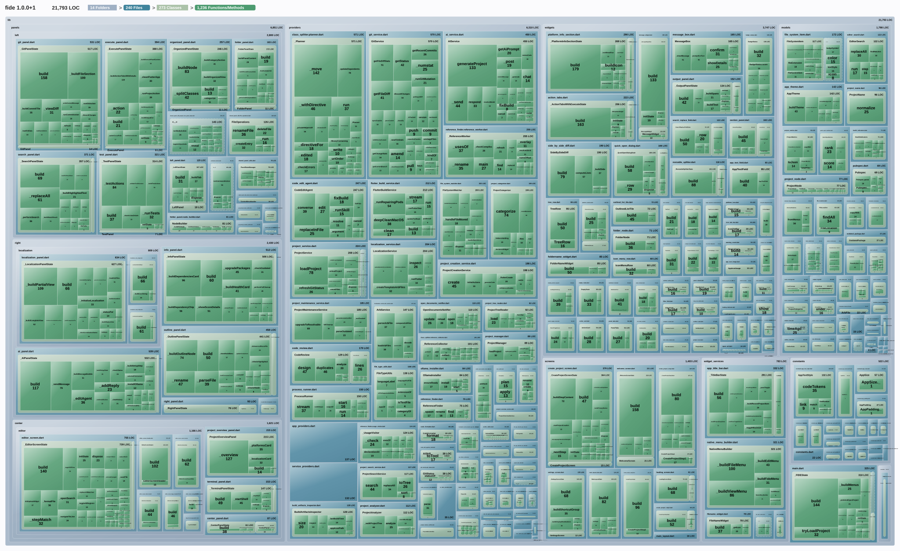

# FIDE - Flutter Integrated Developer Environment

FIDE is an open-source, opinionated IDE for Flutter development, built in Flutter. It is not a general-purpose editor: every panel is designed around a Flutter project, and code quality is part of the workflow, measured by [fCheck](https://github.com/vteam-com/fCheck) and assisted by a local AI model that never sends your code to the cloud.

 

## Philosophy

- **Flutter first**: the project tree, run targets, tests, localization and quality checks all understand Flutter projects
- **Quality built in**: fCheck scores the project and lists what to fix, and FIDE fixes what it can by itself
- **Deterministic before AI**: mechanical refactorings run as instant quick fixes; the local model only gets what code cannot decide
- **Private by default**: analysis runs locally, and the AI runs on your machine through [Ollama](https://ollama.com)
- **Open source**: community-driven, with transparent development

## FIDE and fCheck

[fCheck](https://github.com/vteam-com/fCheck) is a companion project: a fast, local quality analyzer for Flutter and Dart that scores a project from 0 to 100% across code size, dead code, documentation, duplicate code, hardcoded strings, layers, magic numbers, localization and more. It runs as a CLI and as a Dart package.

FIDE uses fCheck as a Dart package (`package:fcheck/fcheck.dart`). fCheck is the brain, and FIDE is the workbench:

| fCheck finds | FIDE does with it |
| --- | --- |
| The project score and each analyzer's deduction | Shows them in the **Project Overview** and the **Info** panel, with the best practice behind each issue |
| Each finding's file and line | Opens the finding in the editor |
| Hardcoded strings, their role and their `BuildContext` | **Quick fixes**: moves user-facing strings into ARB files and replaces them with localization lookups, or turns lookup keys into named constants |
| Missing and out-of-sync translations | The **Localize** panel translates ARB keys in small batches with the local model |
| Duplicate code, the largest classes, the most coupled files, layer violations | **D.R.Y.** and **S.O.L.I.D.** reviews in the AI panel, which send the model only that focused context, not the whole `lib` folder |

FIDE never reimplements analysis. When FIDE needs a new finding or metric, it is added to fCheck first, kept general for all of fCheck's users, and then used by FIDE.

FIDE holds itself to the same standard: its own code must score 100% with `fcheck --strict` (see `tool/check.sh`).

## Features

### Project and editing

- **Project explorer** with several views
  - **Organized**: the project grouped by role: Root, Lib, Tests, Assets, Platforms, Output
  - **Folder**: the classic file tree
  - **Git**: staged, unstaged and untracked files
- **Code editor** with Dart syntax highlighting, search and replace, go to line, quick open, side-by-side diffs and image preview
- **Outline** of the current file's classes and members, with their callers
- **Preview** of the current file's `@Preview` widgets, live as you save: FIDE runs them headless on the Dart VM (so `dart:io` and assets work), streams each frame into the panel and forwards your clicks and scrolls. Switch it to **Project** to list every preview of the project, collapsed and filterable: only the one you expand is rendered, so it scales to any number of previews. A preview whose code sets no size is sized to its content; when its width follows the panel or it has no natural height, **Fix Size** writes the size it rendered at into its `@Preview(size: ...)`. For a file without previews, **Generate Previews** writes them, with sample values picked from each parameter's type; the AI writes those that need model objects
- **Search** across the project
- **Terminal** opened in the project folder

### Build, run and test

- **Run**: build, run, debug and clean for each supported platform, with clickable `path:line:column` links in the output
- **Test**: run the project's tests and coverage
- **Create project**: a three-step wizard for new Flutter apps

### Quality and localization

- **Project overview**: icon, version, fCheck score, code size, platforms, tests, coverage and translations, shown when no file is open
- **Info panel**: every fCheck deduction with its findings and the best practice that fixes it
- **Localize panel**: sets up `gen-l10n`, lists each ARB key with its translations, and translates missing keys with the local model

### Git

- Stage and unstage single files or everything
- Commit, push and pull
- View diffs and recent commits

### AI assistant

The AI panel works like a terminal session: your prompts, the model's Markdown replies and each tool step in one transcript. You can select text across messages and copy any entry to the clipboard.

| Action | What it does |
| --- | --- |
| Ask AI | Answers questions, with the selected file as context |
| Explain / Generate / Refactor Code | Explains, writes or reshapes code |
| Fix Build | Fixes the errors of the last failed build |
| D.R.Y. review | Reviews the duplicate code fCheck found |
| S.O.L.I.D. review | Reviews fCheck's largest and most coupled code against SOLID |

When you ask for a change, the AI edits the project files itself instead of replying with code to paste. FIDE installs Ollama, starts it and downloads the model for you. See [AI_SETUP.md](AI_SETUP.md).

### Layout

- Left, center, bottom and right panels, each hidden, minimized or maximized
- Light, dark and system themes, with whole-UI zoom
- Recent projects on the welcome screen
- Native builds for macOS, Windows and Linux

| Shortcut | Action |
| --- | --- |
| ⌘1 / ⌘2 / ⌘3 | Cycle the left, bottom and right panels through Hide, Min and Max |
| ⌃1 / ⌃3 | Show the next left or right panel tab |
| ⌘+ / ⌘- / ⌘0 | Zoom in, out, or back to 100% |

All shortcuts are listed in **Settings**.

## Getting Started

1. Clone this repository
2. Run `flutter pub get`
3. Run `flutter run -d macos` (or `windows`, `linux`)
4. Open a Flutter project folder, or create a new one

## Building

- macOS: `flutter build macos`
- Windows: `flutter build windows`
- Linux: `flutter build linux`

## Requirements

- Flutter SDK (Dart `^3.13.7`)
- Git, for the Git view
- [Ollama](https://ollama.com), only for the AI and translation features; FIDE can install it for you

## Contributing

Contributions are welcome. Please:

1. Open an issue first to discuss what you'd like to change
2. Follow the rules in [AGENTS.md](AGENTS.md)
3. Run `tool/check.sh` before opening a pull request: analyze, tests and an fCheck score of 100%

To refresh the screenshots, run `tool/screenshots.sh` on macOS: it opens this repository in FIDE and saves each view to `docs/screenshots`.

## Architecture

fCheck draws the project's structure. FIDE's folders and their dependencies:

Lines of code per file:

## License

This project is licensed under the MIT License.
