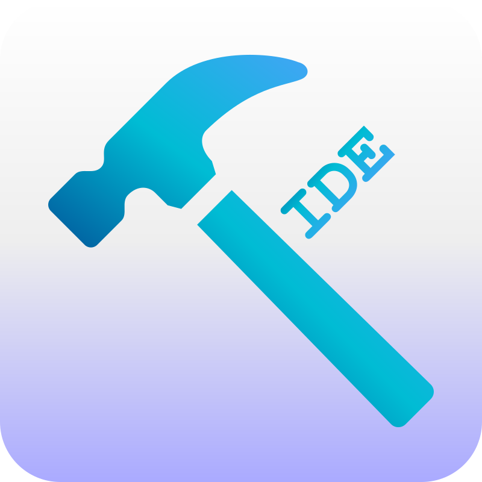
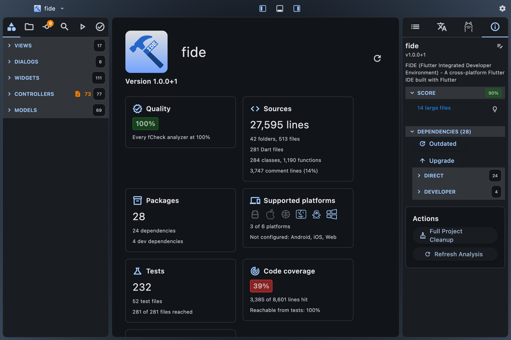
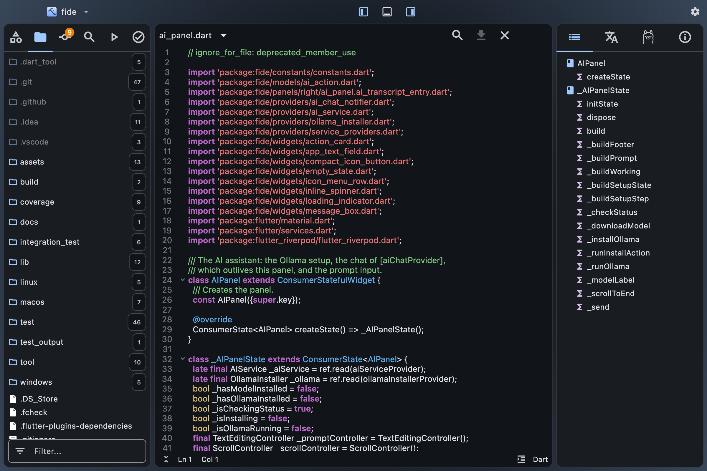
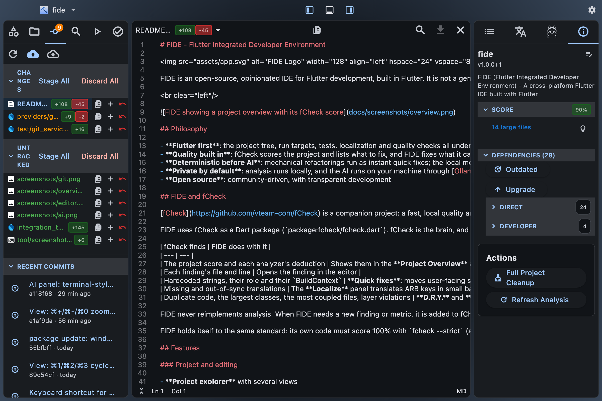
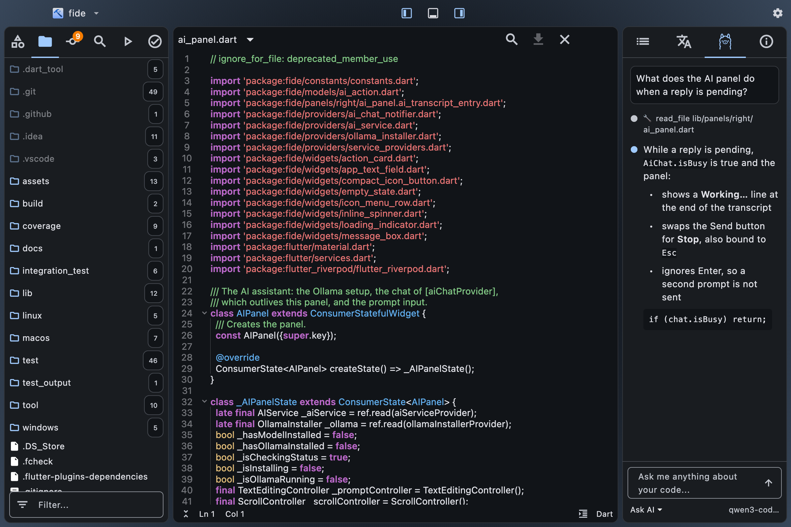
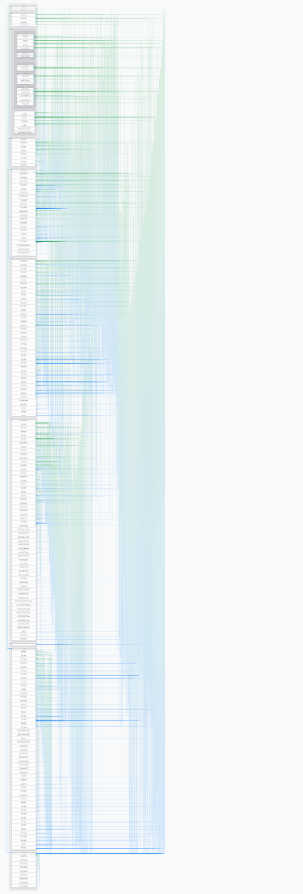

# FIDE - Flutter Integrated Developer Environment



FIDE is an open-source, opinionated IDE for Flutter development, built in Flutter. It is not a general-purpose editor: every panel is designed around a Flutter project, and code quality is part of the workflow, measured by [fCheck](https://github.com/vteam-com/fCheck) and assisted by a local AI model that never sends your code to the cloud.

<br clear="left"/>



## Download

[](https://github.com/vteam-com/FIDE/releases/latest)

| Platform | Latest build |
| --- | --- |
| macOS | [FIDE-macos.zip](https://github.com/vteam-com/FIDE/releases/latest/download/FIDE-macos.zip) |
| Windows | [FIDE-windows.zip](https://github.com/vteam-com/FIDE/releases/latest/download/FIDE-windows.zip) |
| Linux | [FIDE-linux.tar.gz](https://github.com/vteam-com/FIDE/releases/latest/download/FIDE-linux.tar.gz) |

The builds are not signed: on macOS, allow the first launch in **System Settings › Privacy & Security › Open Anyway**; on Windows, pick **More info › Run anyway**. To run FIDE from its source code instead, see [Getting Started](#getting-started). What changed in each release is in [CHANGELOG.md](CHANGELOG.md).

### Updates

FIDE keeps itself up to date. It looks for a newer release at launch and every four hours; when one is out, it tells you and shows an update button in the title bar, beside Settings. Click it when you're ready: FIDE downloads the new build, saves your open files, quits, and restarts updated. **Settings › Updates** shows the version you run and checks again on demand.

FIDE replaces itself where it is installed, so it needs to be able to write there: on macOS, move `FIDE.app` to **Applications** before its first launch (an app opened from **Downloads** runs from a read-only copy), and on Windows and Linux keep its folder in one you own. FIDE run from its source code never updates itself: Git does.

## Philosophy

- **Flutter first**: the project tree, run targets, tests, localization and quality checks all understand Flutter projects
- **Quality built in**: fCheck scores the project and lists what to fix, and FIDE fixes what it can by itself
- **Deterministic before AI**: mechanical refactorings run as instant quick fixes; the local model only gets what code cannot decide
- **Private by default**: analysis runs locally, and the AI runs on your machine through [Ollama](https://ollama.com)
- **Open source**: community-driven, with transparent development

## FIDE and fCheck

[fCheck](https://github.com/vteam-com/fCheck) is a companion project: a fast, local quality analyzer for Flutter and Dart that scores a project from 0 to 100% across code size, dead code, documentation, duplicate code, hardcoded strings, layers, magic numbers, localization and more. It runs as a CLI and as a Dart package.

FIDE uses fCheck as a Dart package (`package:fcheck/fcheck.dart`). fCheck is the brain, and FIDE is the workbench:

| fCheck finds | FIDE does with it |
| --- | --- |
| The project score and each analyzer's deduction | Shows them in the **Project Overview** and the **Info** panel, with the best practice behind each issue |
| Each finding's file and line | Opens the finding in the editor |
| Hardcoded strings, their role and their `BuildContext` | **Quick fixes**: moves user-facing strings into ARB files and replaces them with localization lookups, or turns lookup keys into named constants |
| Missing and out-of-sync translations | The **Localize** panel translates ARB keys in small batches with the local model |
| Duplicate code, the largest classes, the most coupled files, layer violations | **D.R.Y.** and **S.O.L.I.D.** reviews in the AI panel, which send the model only that focused context, not the whole `lib` folder |

FIDE never reimplements analysis. When FIDE needs a new finding or metric, it is added to fCheck first, kept general for all of fCheck's users, and then used by FIDE.

An analysis still being evaluated can start in FIDE, written the way fCheck's analyzers are, and moves into fCheck once it proves its value: today the Analyzer tab's **Repeated Widget Settings** and the **Color contrast** check.

FIDE holds itself to the same standard: its own code must score 100% with `fcheck --strict` (see `tool/check.sh`).

## Features

### Project and editing

- **Project explorer** with several views
  - **Organized**: the project grouped by role: Root, Lib, Tests, Assets, Platforms, Output
  - **Folder**: the classic file tree
  - **Git**: staged, unstaged and untracked files
- **Code editor** with Dart syntax highlighting, search and replace, go to line, quick open, side-by-side diffs and image preview
- **Audio editor** for sound files (WAV, MP3, Ogg, M4A, AAC, FLAC): play and stop, trim on the waveform, change the speed without changing the pitch and the pitch (±12 semitones) without changing the speed, then save over the file in its own format. WAV is handled natively; other formats convert through `afconvert` (built into macOS) or `ffmpeg`, which saving MP3 and Ogg needs
- **Outline** of the selected file, right under its row in the Organized and Folder trees (click the file again to fold it): a Dart file's classes and members, with how many callers each has, a Markdown file's headings, a YAML file's keys. Under the `build` the cursor is in (any function returning widgets) unfolds its **widget tree**: every widget nested under the parent whose slot it fills (`child`, `children`, `body`, `appBar`, `title`, builders, ...), through `if`, `for`, `?:` and `.map(...)`, with helper calls such as `_buildHeader()` and widget variables marked as references; other functions show how many widgets they build. The cursor highlights its path down the tree, and a click jumps to the entry. Each widget's menu, on its ⋯ button under the cursor or a right-click, reshapes the tree in one step, without the AI: **Wrap with** Padding, Center, Expanded, SizedBox, Column, Row, Stack, Builder or any widget you name; **Remove this widget**, its child or children taking its place; **Swap with parent**; and **Move up** or **Move down** among the widgets of its list. The file is saved and formatted, and the caret lands on the widget edited
- **Preview** of the current file's `@Preview` widgets, live as you save: FIDE runs them headless on the Dart VM (so `dart:io` and assets work), streams each frame into the panel, on the same Transparent / Black / White / Rainbow backdrop picked for images, and forwards your clicks and scrolls. Switch it to **Project** to list every preview of the project, collapsed and filterable: only the one you expand is rendered, so it scales to any number of previews. A preview whose code sets no size is sized to its content; its width and height are each **Auto** or fixed, your choice: click either to switch, or drag the grips on the right of and under the preview to resize it in 10-px steps, then **Fix Size** writes what you picked into its `@Preview(size: ...)` (`Size(w, h)`, `Size.fromWidth`, `Size.fromHeight`, or no size). For a file without previews, **Generate Previews** writes them, with sample values picked from each parameter's type; the AI writes those that need model objects
- **Search** across the project
- **Terminal** opened in the project folder



### Build, run and test

- **Run**: build, run, debug and clean for each supported platform, with clickable `path:line:column` links in the output, then manage the project's packages: the direct and developer dependencies, each opening its pub.dev page, flagged when outdated or conflicting, **Outdated** and **Upgrade**, and editing `pubspec.yaml`
  - **Hot reload**: while **Run Debug** runs, each save hot reloads the app, and restarts it when a change can't be hot reloaded; **Hot Reload** and **Hot Restart**, beside its Stop and in the **Run** menu, apply the saved code at once, and their compile errors feed the AI's **Fix Build**
- **Test**: run the project's tests and coverage
- **Create project**: a three-step wizard for new Flutter apps

### Quality and localization

- **Project overview**: icon, version, fCheck score, code size, platforms, tests, coverage and translations, shown when no file is open
- **Info panel**, the right panel's first tab, about what is selected, then the project: the selected file's path and actions (and an image's dimensions, color mode, transparency and dominant colors); the declaration under the cursor with its **callers** and what it **calls** in the project, each a click away; the live **preview** of the widget class the cursor is in, when it has a `@Preview`; then the project's version and every fCheck deduction with its findings and the best practice that fixes it
- **Localize panel**: sets up `gen-l10n`, lists each ARB key with its translations, and translates missing keys with the local model
- **Accessibility**: each text and icon color the code gives, and each on-color of the project's color schemes, judged against what it is drawn on in every theme the app renders, at WCAG 2 level AA. The overview's Accessibility card shows the share that reads; its view counts the elements judged by kind and contrast range, shows the color scheme of each theme and where it is defined, and lists every color the code writes, the most used first. Colors that fall short are listed with their file and line among the quality issues and lower the score; end a line with `// ignore: fcheck_color_contrast` to skip it

### Git

- Stage and unstage single files or everything
- Commit, push and pull
- View diffs and recent commits



### AI assistant

The AI panel works like a terminal session: your prompts, the model's Markdown replies and each tool step in one transcript. You can select text across messages and copy any entry to the clipboard.

| Action | What it does |
| --- | --- |
| Ask AI | Answers questions, with the selected file as context |
| Explain / Generate / Refactor Code | Explains, writes or reshapes code |
| Fix Build | Fixes the errors of the last failed build |
| D.R.Y. review | Reviews the duplicate code fCheck found |
| S.O.L.I.D. review | Reviews fCheck's largest and most coupled code against SOLID |

When you ask for a change, the AI edits the project files itself instead of replying with code to paste. FIDE installs Ollama, starts it and downloads the model for you. See [AI_SETUP.md](AI_SETUP.md).



### Layout

- Left, center, bottom and right panels, each shown or hidden; ⌥-click a panel toggle, or click the active tab of the left or right panel again, to show it large
- Light, dark and system themes, with whole-UI zoom
- Recent projects on the welcome screen
- Native builds for macOS, Windows and Linux

| Shortcut | Action |
| --- | --- |
| ⌘1 / ⌘2 / ⌘3 | Show or hide the left, bottom and right panels |
| ⌃1 / ⌃3 | Show the next left or right panel tab |
| ⌘+ / ⌘- / ⌘0 | Zoom in, out, or back to 100% |
| ⌘\ / ⇧⌘\ | Hot reload or hot restart the app Run Debug runs |

All shortcuts are listed in **Settings**.

## Getting Started

1. Clone this repository
2. Run `flutter pub get`
3. Run `flutter run -d macos` (or `windows`, `linux`)
4. Open a Flutter project folder, or create a new one

## Building

- macOS: `flutter build macos`
- Windows: `flutter build windows`
- Linux: `flutter build linux`

## Releasing

Pushes to `main` only run the tests. To ship the code in its current state, from an up-to-date `main` with no pending changes:

```sh
tool/release.sh patch   # or minor, major, or an exact version such as 1.2.0
```

The script sets the new version in `pubspec.yaml` (the build number goes up by one) and adds the release to [CHANGELOG.md](CHANGELOG.md), one line per commit subject since the last release, which it shows before you confirm. It then runs the analyzer, the tests, `fcheck --strict` and a macOS build, commits the version and the changelog, tags them `v1.2.0` and pushes both. If any step fails, both files are put back and nothing is committed. A release tag found only on your machine, never pushed, is left over from an earlier try: the release moves it.

The pushed tag starts the Release workflow, which checks that the tag matches `pubspec.yaml`, tests the code, builds it for macOS, Windows and Linux, and publishes the three builds as the latest GitHub Release, which the [Download](#download) links serve as soon as the workflow ends, and which running FIDEs then offer to [update](#updates) to. It then deletes the older releases (their tags stay), so GitHub stores only the latest build. To try a release first, run the Release workflow from the Actions tab: it builds any branch and keeps the builds as workflow artifacts, without making a release. Each Release run deletes the build artifacts of the runs before it.

## Requirements

- Flutter SDK (Dart `^3.13.7`)
- Git, for the Git view
- [Ollama](https://ollama.com), only for the AI and translation features; FIDE can install it for you

## Contributing

Contributions are welcome. Please:

1. Open an issue first to discuss what you'd like to change
2. Follow the rules in [AGENTS.md](AGENTS.md)
3. Run `tool/check.sh` before opening a pull request: analyze, tests and an fCheck score of 100%

To refresh the screenshots, run `tool/screenshots.sh` on macOS: it opens this repository in FIDE and saves each view to `docs/screenshots`.

## Architecture

fCheck draws the project's structure. FIDE's folders and their dependencies:



Lines of code per file:


## License

This project is licensed under the MIT License.
